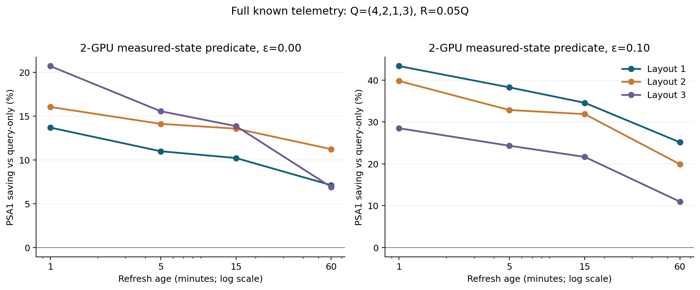
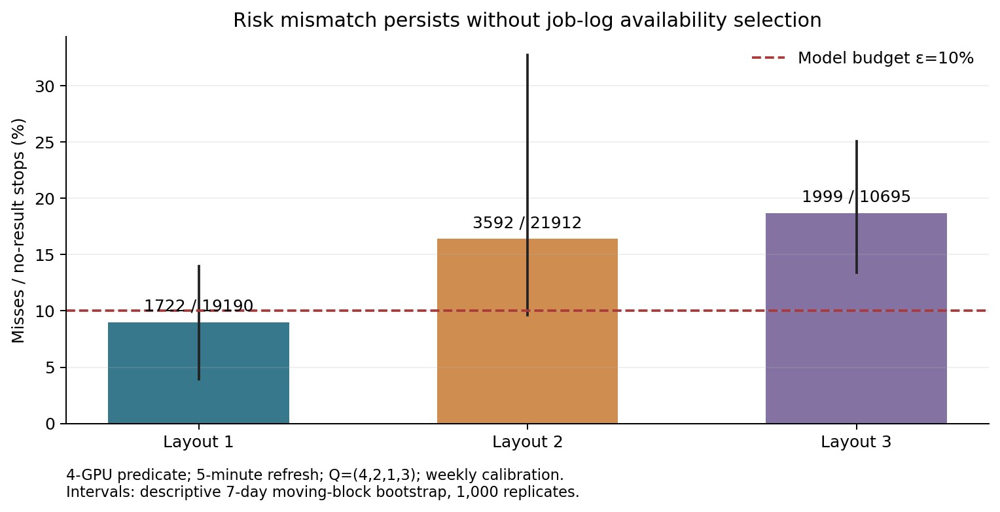

# Microsoft Philly: adatminőségi audit és IA-OSR replay

2026. november 16. — első, reprodukálható változat

**Az eredeti Microsoft-adatokon az audit és a futtatások elkészültek.** Az elsődleges összehasonlítás a teljes ismert telemetriát használja: 224 konfiguráció és hat módszer, azaz 1344 eredménysor. Külön, további 448 konfiguráció vizsgálja a feladatnaplóval is párosítható részmintát. Összesen **672 kiértékelési konfiguráció és 4032 eredménysor** készült; az átfedő időpontok és paraméterváltozatok nem független kísérletek.

A fő eredmény: az információval javított sorrend megengedett kihagyás nélkül is költséget takarít meg; pozitív kockázati keretnél több esetben a PSA1 is javít a H1-hez képest. A becsült modell kockázati korlátja ugyanakkor nem teljesül automatikusan a későbbi mérési idősoron. Általános PSA1-közeloptimalitást nem állítunk.

## 1. Forrás, feldolgozás és adatminőség

A teljes eredeti [Microsoft Philly-archívumot](https://github.com/msr-fiddle/philly-traces) letöltöttem és ellenőriztem: 1 055 988 361 bájt, SHA-256 `2037ccf63a725a02be718b0e1aeee6142c90b7f62d0d849295120e9f6ba13d2c`, commit `29a1b87fa2d9ed80b83c9e3a37f3a88d382b031d`.

Ténylegesen feldolgozott bemenet: 44,750,640 GPU-telemetriarekord, 45,003,060 hostmemória-rekord, 117,325 feladat és 159,351 futtatási kísérlet. A telemetria 552 gépazonosítót tartalmaz. A nyers forrás és a kutatás alapcikke: [Jeon és szerzőtársai, USENIX ATC 2019](https://www.usenix.org/conference/atc19/presentation/jeon).

A kísérletek 24, a tanítási időszakban jól megfigyelt gép nyolc-nyolc GPU-csatornáját használják. Először rögzített hash-sorrendben 96 gépazonosítót vettem, majd a 24-et kizárólag a november 1. előtti mérési lefedettségből választottam. Nem használtam későbbi alkalmasságot vagy algoritmuseredményt a gépválasztáshoz.

Az audit során három problémát kellett külön kezelni:

- **Hibás leltárcímkék.** A jobnaplóban megjelenő 415 gépből 238 olyan GPU-indexet is kapott, amely meghaladja a leltárban megadott darabszámot. Például a `m29` két GPU-sként szerepel, de nyolc megfigyelt GPU-csatornája és nyolcig terjedő kiosztása van. Ugyanezt a hivatalos adattár [8. hibajegye](https://github.com/msr-fiddle/philly-traces/issues/8) is jelzi. A kapacitás- és névleges VRAM-címkéket ezért nem használjuk; a gyökérokot nem találgatjuk.
- **Eltérő időjelölés.** A telemetria PDT/PST jelölése explicit. A jobnapló időzónája nincs dokumentálva. A YARN application ID-k ResourceManager-epochja és több első beküldés közötti 9–12 másodperces különbség UTC-t támogat. Ezt az időeltolási érzékenységvizsgálat is támogatja. Az UTC-értelmezés dokumentált következtetés; a bizonyítékokat CSV-k őrzik. Az application ID jelentését a [Hadoop API](https://hadoop.apache.org/docs/r2.7.7/api/org/apache/hadoop/yarn/api/records/ApplicationId.html) dokumentálja.
- **Hiányos foglalási napló.** 136 kísérletnél nincs értelmezhető kezdés, 6695 esetben befejezés, 48 esetben hibás a végpontok sorrendje. Az ilyen időszakok bizonytalanok maradnak. A nyilvános workload részhalmaz; a napló hiánya nem bizonyít üres GPU-t.

A részletes audit és a foglalási részminta eredményei a [külön mellékanyagban](Philly_joint_subset_details_hu.md) olvashatók. Az elsődleges, alább közölt kontroll a foglalási bizonytalanság miatt **nem dob el egyébként jól mért terhelési/memóriapontokat**.

## 2. A kísérlet pontos jelentése

Egy gép megfigyelési feltétele: legalább két, illetve négy GPU-n a mért terhelés legfeljebb 20%, és a host `mem_free/mem_total` aránya legalább 5%. Ez **mért állapotra épülő jelöltpredikátum**, nem új feladat scheduler által igazolt elhelyezhetősége. Dinamikus szabad GPU-VRAM-ot nem mérünk. Az abszolút hostmemória-egység feltételezése helyett dimenziótlan arányt használunk.

Három elrendezés készült; mindegyik négy virtuális domainből áll, domainenként két géppel. A 24 gépet rögzített, 2026-os magú permutáció osztja három diszjunkt nyolcgépes csoportba. A csoportok valódi méréseket használnak, de a domainhatárok modellezettek; nem állítunk valódi federációt vagy racktagságot.

A tanítás november 1. előtt történik, majd a teszt előtt egyórás rést hagyunk. A source percét csak a perc végén tekintjük elérhetőnek. A REFRESH az 1, 5, 15 vagy 60 perccel korábbi állapotjel. Minden elrendezésen belül a két intent, a négy késleltetés és minden algoritmus ugyanazokat a tesztidőpontokat használja. A teszthalmazok mérete 61 185, 62 788 és 64 129 perc; nincs interpoláció vagy forward-fill.

Két kalibráció: statikus, teszt előtti modell; illetve heti frissítés az előző 14 napból, legalább 100 páros megfigyelés hiányában kifejezett statikus visszatéréssel. Csak korábban bekövetkezett megfigyelések használhatók. A posteriorok Laplace-simított pontbecslések, nem statisztikai felső kockázati korlátok. A domainek függetlenségét a döntési modell feltételezi; a mérési adatokat nem függetlenítettük mesterségesen.

A QUERY-költség (1,1,1,1) vagy (4,2,1,3); a REFRESH ennek 5%-a, és az első elrendezés négy-GPU-s eseteiben 20%-os érzékenységvizsgálat is szerepel. Minden költség modellezett, normalizált érték; nincs mért hálózati RTT. Hat módszer: query-only, risk-aware query, screening-greedy, H1, PSA1 és egzakt Bellman-DP.

## 3. Költségelőny megengedett kihagyás nélkül

Az ε=0 kontrollban minden megmaradt bizonytalanságot pontos QUERY old fel. A refresh az ellenőrzések sorrendjét javíthatja, de kockázati SKIP vagy feloldatlan domain melletti STOP nincs. A költségelőny ezért nem az elfogadott elmulasztásokból ered.

Teljes ismert telemetria, egyperces refresh, adaptív kalibráció, Q=(4,2,1,3), R=0,05Q, ε=0:

| Elrendezés | Kért GPU/gép | Tesztpont | Query-only | PSA1 | Megtakarítás | Elmulasztás |
| --- | --- | --- | --- | --- | --- | --- |
| 1 | 2 | 61185 | 3.8356 | 3.3101 | 13.70% | 0 |
| 1 | 4 | 61185 | 4.8046 | 4.4984 | 6.37% | 0 |
| 2 | 2 | 62788 | 5.4918 | 4.6102 | 16.05% | 0 |
| 2 | 4 | 62788 | 5.9755 | 5.1626 | 13.60% | 0 |
| 3 | 2 | 64129 | 3.3209 | 2.6328 | 20.72% | 0 |
| 3 | 4 | 64129 | 4.5842 | 3.7441 | 18.33% | 0 |

A két-GPU-s esetekben a megtakarítás **13,70–20,72%**, a négy-GPU-s esetekben **6,37–18,33%** volt, a megfigyelt predikátumokra nulla elmulasztással. Ebben az ε=0 kontrollban a H1 és a PSA1 azonos: az eredmény az információval javított sorrend értékét mutatja, nem a PSA1 egyedi többletét. A nulla elmulasztás az offline, pontos QUERY-val feloldott predikátumokra vonatkozik; nem valós erőforrásfoglalási garancia.

## 4. PSA1 a H1-hez és a többi baseline-hoz képest

Az első elrendezés két-GPU-s esete, egyperces refresh, adaptív kalibráció, Q=(4,2,1,3), R=0,05Q, ε=0,10:

| Módszer | Realizált költség | Megtakarítás | Elmulasztás | Eredmény nélküli lezárás | Feltételes arány |
| --- | --- | --- | --- | --- | --- |
| query_only | 3.8356 | 0.00% | 0 | 9678 | 0.00% |
| risk_query | 3.7063 | 3.37% | 0 | 9678 | 0.00% |
| screening_greedy | 2.6302 | 31.43% | 597 | 10275 | 5.81% |
| h1 | 2.2883 | 40.34% | 491 | 10169 | 4.83% |
| psa1 | 2.1739 | 43.32% | 630 | 10308 | 6.11% |
| exact | 2.1151 | 44.86% | 630 | 10308 | 6.11% |

A PSA1 itt 2,1739, a H1 2,2883, a screening-greedy 2,6302, a DP 2,1151 költséget adott. A PSA1 a query-only-hoz képest 43,32% megtakarítást ért el, de a költség mellé a feltételes elmulasztási arányt is meg kell adni. A módszerek nem feltétlenül ugyanazokat a találatokat engedik el.

Az elsődleges 224 konfigurációban a PSA1 91 esetben olcsóbb, 1 esetben drágább volt a H1-nél; a többi esetben egyezett a realizált költség. A DP-vel 59 esetben egyezett. A tanult független modellek szerinti, időszakokkal súlyozott várható költségben a legnagyobb PSA1/DP-gap **4.88%** volt. Az egzakt DP a becsült modellre optimális, nem szükségszerűen a későbbi mért eloszlásra.

## 5. A kockázati korlát nem vihető át automatikusan a trace-re

A harmadik elrendezés négy-GPU-s esetében, ötperces refresh-sel, heterogén QUERY-költséggel és adaptív kalibrációval a PSA1 **1999/10695 = 18.69%** feltételes elmulasztási arányt adott ε=10% mellett. A leíró, hét napos mozgóblokk-bootstrap 95%-os intervalluma 13.41–25.08%. A kockázati keret feletti pontbecslés tehát a teljes ismert telemetrián is megmarad; nem csak a foglalási naplóval párosított részminta jelensége.

A 112 pozitív kockázati keretű PSA1-konfiguráció közül 41 esetben volt a pontbecslés 10% felett. A nevező az eredmény nélküli lezárások száma, nem az összes kérés; az utóbbi arány külön CSV-oszlop. Ez nem a helyes modellre bizonyított korlát cáfolata: a becslési hiba, az időbeli változás és a domainek függősége egyaránt okozhat eltérést. A jelen vizsgálat e hatásokat még nem választja szét okságilag.

A blokk-bootstrap az időbeli összefüggésre választott skálájú leíró kiegészítés, nem állomásfüggetlen assurance-bizonyítvány. Nulla nevező nincs nullaként kezelve, nulla megfigyelt eseménynél pedig az empirikus intervallum elfajulhat. Minden döntési modellben minden STOP a saját modellje szerinti korláton belül maradt.

## 6. Kedvezőtlen algoritmikus esetek és a részminta szerepe

A teljes telemetrián talált legnagyobb egyedi, tanult modellbeli PSA1/DP-gap 18.69%. A gyorsított és közvetlen continuation 596 megengedett állapotban egyezett a kedvezőtlen modellben.

A foglalási naplóval is párosítható részminta külön 448 konfigurációjában lényegesen rosszabb modell is előkerült: DP=0,406522, PSA1=1,053904, **159,25% egyedi időszakbeli gap**. Ennek a konfigurációnak az időszakokkal súlyozott modell szerinti gapje 16,79%. A közvetlen és gyorsított continuation 990 megengedett állapotban egyezett. Az ellenpélda és paraméterei a `results/algorithmic_counterexample.json` fájlban vannak; a teljes telemetria ellenpéldáját a `results_telemetry_full/algorithmic_counterexample.json` tartalmazza.

Az egyedi modell-gap nem a teljes trace átlagos gapje. A modell szerinti rollout-költségkorlát mindkét esetben teljesült; nem találtunk gyorsítási implementációs hibát. **Általános közeloptimalitási állításra nincs alap.** Az eredmény a több egymásra épülő REFRESH-művelet értékének célzott vizsgálatát indokolja; ez egyelőre kutatási irány, nem kész új algoritmus.

A foglalási részminta feltétele a mért terhelési/memóriakövetelményt a megerősített naplózott foglalások kizárásával egészíti ki, a hiányos rekordokat bizonytalannak hagyva. Sokkal kevesebb időpontot és gyakran szinte üres jelölthalmazt ad. A részminta részletes eredményeit ezért a [külön mellékanyagban](Philly_joint_subset_details_hu.md) kezeljük; nem ez adja az elsődleges költségállítások mintáját.

## 7. Mit ad ez a NOMS-cikkhez?

Az Eagle-pilotnál erősebb kiegészítő esettanulmány: eredeti forrásból feldolgozott, perces mérések, négy domain, sok negatív keresési helyzet, közös időpontokon vizsgált késleltetések és ε=0 kontroll. A friss információ költségértéke kimutatható; pozitív kockázati keretnél a PSA1 több esetben a H1-nél is jobb.

Az assurance szempontjából az eredmény a modellből a trace-re történő kockázatátvitel korlátját mutatja. A nagy megtakarításokat nem szabad igazoltan ε-megengedett, valós scheduler-teljesítményként közölni. A domainhatárok és hálózati költségek modellezettek, a leltárhibák miatt névleges VRAM-kapacitást nem állítunk, a workload naplója pedig részhalmaz.

Most a kedvezőtlen PSA1-modell szerkezetének és a kockázateltérés forrásainak elemzése adhat többet a cikkhez, mint újabb trace-ek önmagukban. A fő algoritmikus garanciák bizonyítéka továbbra is az analitikus eredmény és a pontosan körülhatárolt kontrollált modellvizsgálat.

## 8. Reprodukálás és ellenőrzések

A csomag tartalmazza a 24 gépes mért részhalmazt, a teljes és párosított minták összes eredményét, állapotexportját, napi statisztikáit, tanult modelljeit, mindkét kedvezőtlen esetet, a forrásauditot és a kódot. A nagy eredeti CSV-k az ellenőrzőösszeggel rögzített archívumból újra előállíthatók; az algoritmusok a mellékelt részhalmazzal új letöltés nélkül is futtathatók.

Nyolc célzott ellenőrzés sikeresen lefutott. Minden illesztett független négy-domaines modellben mind a 256 igazság–refresh kimenetet enumeráltuk, és a DP- és PSA1-költségeket a rekurzív értékfüggvénnyel is ellenőriztük. A mérési részhalmaz numerikus mezői float32 formában tárolódnak. A véletlen magok és a függőségek rögzítettek. Az eredeti adatok CC BY 4.0 forrásmegjelölése és a kötelező alapcikk-hivatkozás a README-ben és a `references.bib` fájlban szerepel.
