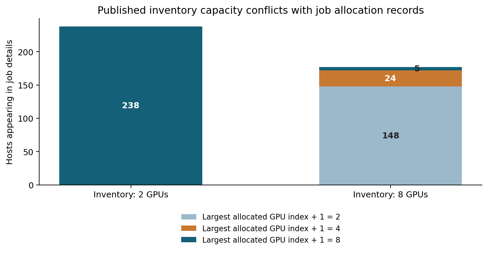
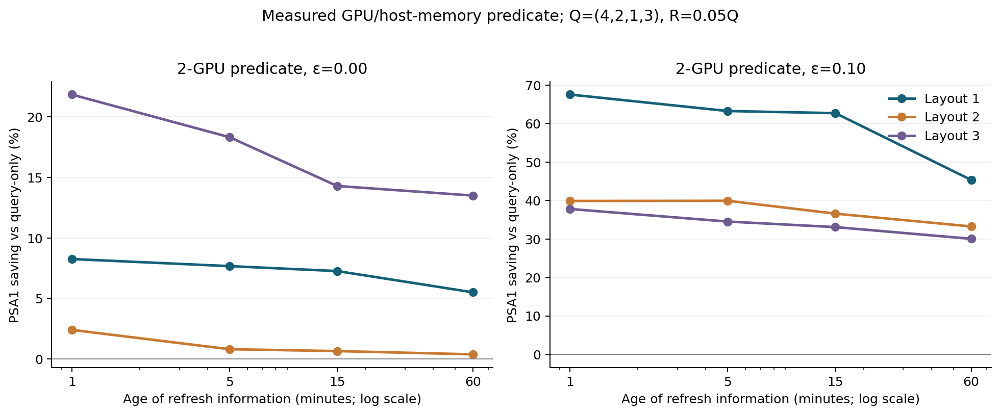
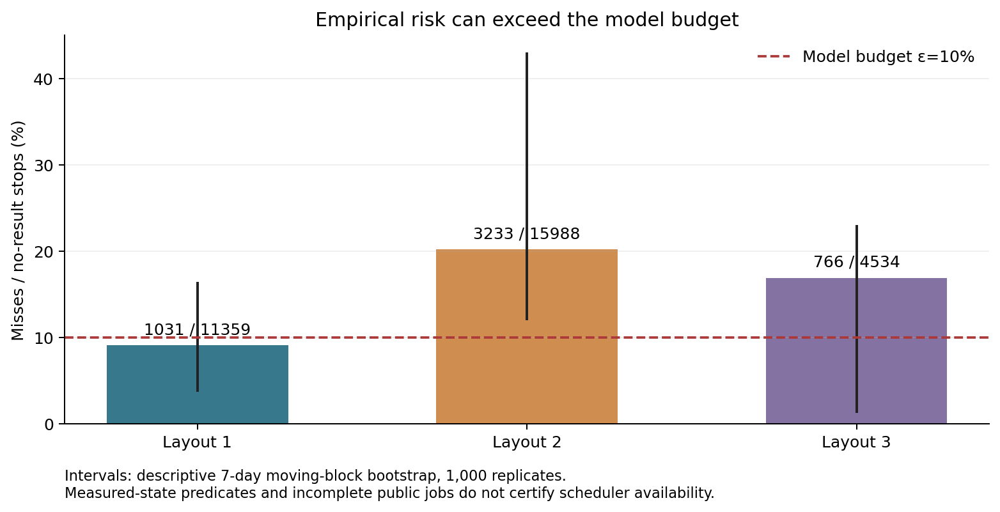

# Microsoft Philly: a foglalási naplóval párosított részminta részletei

2026. november 16. — első, reprodukálható változat

Ez a részletes mellékanyag a foglalási bizonytalanságot is kizáró közös részmintáról szól. A teljes ismert telemetriára készült elsődleges kontroll és az összesített értékelés a [főjelentésben](NOMS2027_Philly_audit_replay_v1_hu.md) található.

**A teljes eredeti archívum beszerzése, az adatminőségi audit és a négy-domaines algoritmus-összehasonlítás elkészült.** Összesen 448 konfiguráció és hat módszer, azaz 2688 összesített eredménysor készült. A feldolgozásban talált leltárhibát nem javítottam feltételezett hardveradatokkal: a kísérlet a megfigyelt GPU-terhelési és hostmemória-feltételekre épül. A jobnapló külön, hiányos foglaltsági bizonyítékként szerepel.

## 1. Forrás és ténylegesen feldolgozott adatok

Hivatalos forrás: [Microsoft Research Philly traces](https://github.com/msr-fiddle/philly-traces), commit `29a1b87fa2d9ed80b83c9e3a37f3a88d382b031d`. A teljes eredeti `trace-data.tar.gz` mérete 1 055 988 361 bájt; SHA-256: `2037ccf63a725a02be718b0e1aeee6142c90b7f62d0d849295120e9f6ba13d2c`. A letöltött állomány mérete és ellenőrzőösszege egyezett a hivatalos Git LFS-bejegyzéssel.

A mérési adatokhoz tartozó alapcikk: M. Jeon és szerzőtársai, *Analysis of Large-Scale Multi-Tenant GPU Clusters for DNN Training Workloads*, USENIX ATC 2019, 947–960. [Cikk és hivatkozás](https://www.usenix.org/conference/atc19/presentation/jeon). A nyilvános állomány a munkaterhelés részhalmaza, nem a teljes üzemeltetési állapotnapló.

Tényleges feldolgozás:

- 44,750,640 GPU-telemetriarekord, 552 gépazonosító.
- 45,003,060 hostmemória-rekord, 552 gépazonosító.
- 117,325 feladat; 159,351 futtatási kísérlet.
- Az elsődleges időrács 2017. október 3-tól december 16. kezdetéig tart. A nyers telemetria utolsó elérhető pontja december 15-én van; a rács későbbi hiányzó pontjait nem töltöttem ki.
- A kísérleti részhalmaz 24 gép nyolc-nyolc megfigyelt GPU-csatornáját használja. A két-/nyolc-GPU-s leltárcímkéket nem használtam a kapacitás meghatározására.

Az anonim gépazonosítók teljes halmazából rögzített hash-sorrendben 96 jelöltet vettem. A 24 gépet kizárólag a november 1. előtti, mind a nyolc GPU-csatornára és a hostmemóriára meglévő mérési lefedettség alapján választottam ki. Az állapotok kedvezősége és az algoritmusok későbbi teljesítménye nem szerepelt a kiválasztásban. A kiválasztott gépeken az átlagos teljes telemetria-lefedettség a tesztidőszakban 99.04%.

## 2. Az audit három fontos megállapítása

**A gépleltár kapacitáscímkéi nem megbízhatók.** Például a `m29` a leltárban két GPU-s gép, miközben a telemetriában nyolc GPU-csatornája, a jobnaplóban pedig nyolcig terjedő GPU-kiosztása szerepel. A jobnaplóban megjelenő 415 gépből 238 esetben található a leltár szerinti darabszámot meghaladó GPU-index. Ez 98,325 gépszintű kiosztási részrekordot érint. Ugyanezt a problémát a hivatalos adattár [nyitott 8. hibajegye](https://github.com/msr-fiddle/philly-traces/issues/8) is leírja. A gyökérokot az adatközlő megerősítése nélkül nem állítjuk; különösen nem feltételezünk önkényes azonosító-átszámozást.

**Az időzónákat külön kellett rendezni.** A telemetria PDT/PST jelölése explicit. A jobnapló időpontjaiban nincs időzóna. A YARN application ID-k beágyazott ResourceManager-kezdőidejét összevetettem az első beküldésekkel: több `_0001` feladat 9–12 másodperccel követi a Unix-epochként értelmezett kezdőidőt, ami az UTC-értelmezést támogatja. A [Hadoop API](https://hadoop.apache.org/docs/r2.7.7/api/org/apache/hadoop/yarn/api/records/ApplicationId.html) dokumentálja az application ID ezen részének jelentését. **Az UTC a nyers adatokból levont, dokumentált következtetés, nem a Philly README-ben megadott időzóna.** Az eltolási érzékenységvizsgálat is a nulla UTC-eltolásnál mutatja a legerősebb terhelés–foglaltság elkülönülést. A bizonyítékokat két CSV őrzi; a végső feldolgozás UTC jobidőket használ.

**A foglalási napló hiányos.** 136 kísérletnél nem értelmezhető a kezdés, 6695 esetben a befejezés, 48 esetben a két végpont sorrendje hibás. A lezárt, érvényes intervallumok megerősített *naplózott* foglaltságot adnak; a hiányos/hibás végpontok bizonytalan időszakot jelölnek. Ez utóbbiakat nem tekintjük sem biztosan foglaltnak, sem szabadnak. A jól körülhatárolt GPU-intervallumok között 1329 átfedő rekord is van; a foglaltsági feltétel ezek unióját használja. Az alacsony GPU-terhelés önmagában nem jelent kiosztható eszközt, és a nyilvános naplóból hiányzó feladat továbbra is jelen lehet a rendszerben.

## 3. A ténylegesen vizsgált feltételek

A két intent egyetlen gépen legalább két, illetve négy olyan GPU-t kíván, amelynek mért terhelése legfeljebb 20%; a host szabad memóriájának aránya legalább 5%. A szabad hostmemória aránya dimenziótlan, ezért nem kell a dokumentálatlan abszolút memóriaegységet feltételezni. **Dinamikus szabad GPU-VRAM-ot nem mérünk.**

Két állapotdefiníció szerepel:

1. `telemetry`: a fenti megfigyelt terhelési és hostmemória-feltétel. Ez alkalmas jelölteket ír le, nem scheduler által igazolt elhelyezhetőséget.
2. `logged_filter`: ugyanez, de a lezárt jobintervallum szerint foglalt GPU nem számítható be. A hiányos jobintervallummal érintett kártya státusza bizonytalan. Ha ebből az intent igazságértéke nem dönthető el, az adott állapot hiányzó marad.

A hiányzó méréseket és bizonytalan állapotokat nem helyettesítem sikertelenséggel. Egy kétgépes domain akkor biztosan pozitív, ha bármelyik gépe igazoltan teljesíti a megfigyelési feltételt; biztosan negatív csak akkor, ha mindkét gép feltétele eldönthetően hamis.

Mindhárom elrendezés négy virtuális domainből áll, domainenként két megfigyelt géppel. A 24 gépet rögzített, 2026-os véletlenmagú permutáció osztja három, egymástól diszjunkt nyolcgépes csoportba. **Ez modellezett csoportosítás, nem valódi federáció vagy ismert racktopológia.** A három elrendezés ugyanannak a klaszternek az időben korrelált részhalmaza, nem három független infrastruktúramérés.

November 1. előtt tanítunk, utána egyórás rést hagyunk. A refresh a domain 1, 5, 15 vagy 60 perccel korábbi állapotjelét fedi fel. Egy elrendezésen belül **mind a négy késleltetés, mindkét intent, mindkét állapotdefiníció és minden algoritmus ugyanazokat a tesztidőpontokat használja**. A bizonytalan foglalási adatok miatt ez jóval kevesebb a puszta telemetria-lefedettségből várható pontszámnál; a teljeseset-elemzés szelekciós hatását nem tekintjük elhanyagolhatónak.

Az állapotok változatossága a közös teszthalmazon:

| Elrendezés | Kért GPU/gép | Predikátum | Közös tesztpont | Egyik domain sem alkalmas |
| --- | --- | --- | --- | --- |
| 1 | 2 | logged_filter | 13970 | 87.90% |
| 1 | 2 | telemetry | 13970 | 50.36% |
| 1 | 4 | logged_filter | 13970 | 99.23% |
| 1 | 4 | telemetry | 13970 | 73.93% |
| 2 | 2 | logged_filter | 20652 | 95.37% |
| 2 | 2 | telemetry | 20652 | 53.39% |
| 2 | 4 | logged_filter | 20652 | 95.37% |
| 2 | 4 | telemetry | 20652 | 61.76% |
| 3 | 2 | logged_filter | 11065 | 99.60% |
| 3 | 2 | telemetry | 11065 | 24.16% |
| 3 | 4 | logged_filter | 11065 | 99.60% |
| 3 | 4 | telemetry | 11065 | 34.05% |

A `telemetry` esetben már gyakori, hogy egyik domain sem teljesíti a feltételt; ez az Eagle-pilotnál változatosabb keresési helyzetet ad. A foglalási szűrő után viszont több esetben szinte mindig üres a jelölthalmaz. Az ottani nagy költségcsökkenés gyakran pusztán a keresés korai elhagyását jelenti, ezért abból önmagában nem állítunk algoritmikus előnyt.

## 4. Döntési modell, baseline-ok és kontrollok

A QUERY/REFRESH/SKIP/STOP döntési modell és az eredeti, auditált PSA1-kód változatlan szemantikával fut. Hat módszer: query-only, risk-aware query, screening-greedy, H1-rollout, PSA1-rollout, egzakt Bellman-DP. Minden illesztett független domainmodellben mind a 256 lehetséges igazság–refresh kimenetet enumeráltuk, és a DP-, valamint PSA1-költséget a rekurzív értékfüggvénnyel is összevetettük.

A QUERY-költség vagy (1,1,1,1), vagy (4,2,1,3). A REFRESH a megfelelő QUERY-költség 5%-a; az első elrendezés négy-GPU-s eseteiben 20%-os érzékenységvizsgálat is készült. **Minden kommunikációs költség modellezett, normalizált érték; nincs mért hálózati RTT.** A keresés alatt az adott perc megfigyelési predikátuma rögzített.

Két kalibráció: statikus, teszt előtti modell; illetve heti frissítés az előző 14 napból. Ha a közös, ismert múltban nincs legalább 100 páros megfigyelés, az adaptív változat kifejezetten a teszt előtti statikus modellre tér vissza. Ez 64/1632 paraméter–időszak kombinációt érintett; a jelző a modellek között szerepel. Sem az újrabecslés, sem a visszatérés nem használ jövőbeli tesztadatot. A gyakoriságokat Laplace-simítás egészíti ki; ezek pontbecslések, nem kockázati felső korlátok.

## 5. Költségelőny megengedett kihagyás nélkül

Az ε=0 kontrollban sem SKIP, sem feloldatlan domain melletti kockázati STOP nem engedhető meg. A refresh az ellenőrzések sorrendjét javíthatja; minden ténylegesen megmaradt bizonytalanságot QUERY old fel. Az alábbi eredmény ezért nem a találatok kockázatos elengedéséből származik.

`telemetry`, egyperces refresh, adaptív kalibráció, Q=(4,2,1,3), R=0,05Q, ε=0:

| Elrendezés | Kért GPU/gép | Tesztpont | PSA1-költség | Megtakarítás a query-only-hoz képest | Elmulasztás |
| --- | --- | --- | --- | --- | --- |
| 1 | 2 | 13970 | 6.4992 | 8.25% | 0 |
| 1 | 4 | 13970 | 8.3027 | 1.77% | 0 |
| 2 | 2 | 20652 | 7.0151 | 2.41% | 0 |
| 2 | 4 | 20652 | 7.8581 | 2.60% | 0 |
| 3 | 2 | 11065 | 4.5870 | 21.83% | 0 |
| 3 | 4 | 11065 | 5.7356 | 8.19% | 0 |

A két-GPU-s esetek 2,41–21,83% megtakarítást adtak a query-only sorrendhez képest, a megfigyelt predikátumokra nulla elmulasztással. Ebben a kontrollban a H1 és a PSA1 azonos volt; a nyereség az információval javított sorrend értékét mutatja, nem a PSA1 egyedi előnyét. A 21,83%-os eset leíró hét napos blokk-bootstrap intervalluma 5,27–31,26%; a három elrendezés eltérő eredménye és a modellezett költségprofil korlátozza az általánosítást. Az ε=0 eredmény az offline, pontos QUERY-val feloldott mérési predikátumokra vonatkozik, nem új feladatok valós erőforrásfoglalására.

## 6. PSA1 a korábbi heurisztikákhoz képest

Az első elrendezés két-GPU-s `telemetry` esete, egyperces refresh, adaptív kalibráció, Q=(4,2,1,3), R=0,05Q, ε=0,10:

| Módszer | Realizált költség | Megtakarítás | Elmulasztás | Eredmény nélküli lezárás | Feltételes arány |
| --- | --- | --- | --- | --- | --- |
| query_only | 7.0839 | 0.00% | 0 | 7035 | 0.00% |
| risk_query | 5.5366 | 21.84% | 6 | 7041 | 0.09% |
| screening_greedy | 2.7823 | 60.72% | 411 | 7446 | 5.52% |
| h1 | 3.0987 | 56.26% | 416 | 7451 | 5.58% |
| psa1 | 2.3015 | 67.51% | 449 | 7484 | 6.00% |
| exact | 2.2581 | 68.12% | 432 | 7467 | 5.79% |

Itt a PSA1 realizált költsége 2,3015, míg a H1-é 3,0987, a screening-greedyé 2,7823, az egzakt DP-é 2,2581. Ez már mutat PSA1-többletet az Eagle kiemelt esetével szemben. A költség és a feltételes elmulasztási arány együtt értékelendő: a módszerek eltérő találatokat hagyhatnak el, és a 10%-os korlát a tanult modellre, nem igazoltan a későbbi trace-re érvényes.

A teljes, 448 konfigurációs rácsban a PSA1 103 esetben olcsóbb, 9 esetben drágább volt a H1-nél, a többi esetben egyezett a realizált költség. A PSA1 és a DP 290 konfigurációban adott azonos realizált költséget. A rács ismétlődő megfigyeléseket és kapcsolódó paraméterváltozatokat tartalmaz; ezek a darabszámok nem független statisztikai próbák.

**Lényeges kedvezőtlen esetet is találtunk.** Egy tanult, független négy-domaines modellben a DP várható költsége 0.406522, a PSA1-é 1.053904: az eltérés 159.25%. Ez egyetlen kalibrációs időszak modellje; a konfiguráción belüli időszakokkal súlyozott, legnagyobb modell szerinti átlagos gap 16.79%. Az egyedi nagy eltérés nem azonos a teljes trace átlagával.

A gyorsított és közvetlen PSA1-continuation értéke a kedvezőtlen modell 990 megengedett állapotában egyezett. A modell szerinti rollout-költségkorlát is teljesült; a nagy gap tehát nem cáfolja ezt a korlátot, és a vizsgálat nem mutatott gyorsítási implementációs hibát. **Általános közel-optimalitási állítást ebből az eredményből nem lehet tenni.** A pontos paraméterek, gyökérállapotbeli döntések és értékek az `algorithmic_counterexample.json` fájlban szerepelnek. A közös REFRESH-döntések értékének elemzése indokolt következő algoritmikus feladat; ez itt még vizsgálati hipotézis.

## 7. A modell szerinti és a trace-en realizált kockázat

A feltételes elmulasztási arány nevezője az eredmény nélküli kereséslezárások száma, nem az összes kérés. Az utóbbi nevezővel számított arány külön oszlop a CSV-ben. A nulla nevező nincs nullaként kezelve.

A második elrendezés négy-GPU-s `telemetry` esetében, azonos QUERY-költségekkel, egyperces refresh-sel és adaptív kalibrációval a PSA1 **3233/15988 = 20.22%** feltételes elmulasztási arányt adott ε=10% mellett. A lezárások 38 különböző napra esnek. A hét napos mozgóblokk-bootstrap leíró 95%-os intervalluma 12.14–42.89%. Ez sokkal több negatív esemény, mint az Eagle-pilotban, és konkrétan megmutatja, hogy az alkalmazott pontbecsléses modell korlátja nem vihető át automatikusan a mérési idősorra.

A 224 pozitív kockázati keretű PSA1-konfiguráció közül 37 esetben volt a pontbecslés ε felett. **Ez nem az elméleti, helyes modellre kimondott feltételes korlát cáfolata.** A becslési hiba, a terhelés időbeli változása, a domainek függősége, valamint a kiválasztott közös mérési pontok szelekciós hatása egyaránt befolyásolhatja a tapasztalt kockázatot. A jelen kísérlet ezeket még nem választja szét okságilag.

A blokk-bootstrap figyelembe vesz egy választott időbeli összefüggési skálát, de nem ad állomásfüggetlen assurance-bizonyítványt; a hét napos blokkhossz érzékenységi választás. Nulla megfigyelt elmulasztásnál az empirikus bootstrap-intervallum elfajulhat. A kockázati mezők figyelmeztető státusza ezért megmarad. Minden módszer minden STOP-ja a saját modelljének megengedett kockázatát tartotta be az enumerációs ellenőrzésben.

## 8. Mit használhatunk a cikkben?

Az Eagle-nél erősebb kiegészítő eredményt kaptunk a friss információ értékére: több valóban negatív keresési helyzet, finomabb időfelbontás és ε=0 kontroll áll rendelkezésre. A választott kockázati keret mellett a PSA1 több esetben a H1-hez és a screening-greedyhez képest is javít. Ezzel együtt a módszerek és az egzakt DP közötti különbségeket nem szabad kizárólag a legkedvezőbb példával bemutatni.

Az assurance-állítás szempontjából a pozitív fő tanulság **nem a 10%-os garancia igazolása**, hanem az, hogy a belief-kalibráció és a modellhelyesség ellenőrzése elengedhetetlen. A leltárhiba miatt nem következtetünk a kártyák névleges VRAM-jára; a hiányos jobnapló miatt nem állítunk teljes scheduler-foglaltságot vagy valódi federált edge-validációt.

A következő érdemi munka a kimutatott kedvezőtlen PSA1-modell és a kockázatátvitel hibaforrásainak célzott elemzése. A jelen anyag reprodukálható telemetriaalapú esettanulmányként használható; a fő algoritmikus garanciák bizonyítéka továbbra is az analitikus eredmény és a pontosan körülhatárolt modellvizsgálat.

## 9. Reprodukálhatóság

A csomag tartalmazza a megfigyelt 24 gépes részhalmazt, a forrás- és integritási auditot, a 448 konfiguráció eredményeit, a közös tesztidőpontok állapotexportját, a napi statisztikákat, a tanult modelleket, a kedvezőtlen ellenpéldát és a futtatási kódot. A nagy eredeti CSV-k újra előállíthatók az ellenőrzőösszeggel rögzített eredeti archívumból; a részhalmazzal az algoritmusok újrafuttatásához nincs szükség ismételt teljes letöltésre.

Nyolc célzott ellenőrzés sikeresen lefutott: időzónák és DST, UTC epoch-példa, félig nyílt foglalási intervallumok, foglalt de alacsony terhelésű GPU, hiányzó mérés, bizonytalan feladatvég, közös késleltetési rács és négy-domaines Bellman-enumeráció. A részhalmaz float32 formában tárolja a mért numerikus mezőket; nincs interpoláció vagy munkaterhelés-generálás. A véletlen magok rögzítettek. Az eredeti adatok CC BY 4.0 licencének hivatkozását és a kötelező bibliográfiai adatokat a README és a `references.bib` tartalmazza.
